# AIoT HW2：WHO 各國平均壽命預測 — 多元線性回歸（CRISP-DM）

- 🌐 **線上網站（Vercel）**：`https://<your-project>.vercel.app` ← 部署後替換
- 📓 **Notebook**：[notebooks/HW2_Life_Expectancy_Regression.ipynb](notebooks/HW2_Life_Expectancy_Regression.ipynb)
- 📊 **資料集**：[Life Expectancy (WHO) — Kaggle, KumarRajarshi](https://www.kaggle.com/datasets/kumarajarshi/life-expectancy-who)
- 📄 **報告書 PDF**：[notebooks/HW2_report.pdf](notebooks/HW2_report.pdf)

以 WHO 公開的各國健康與社經指標（193 國、2000–2015、2,938 筆、**20 個特徵**）進行多元線性回歸，依 CRISP-DM 完成資料理解、前處理、特徵選擇、建模、評估（含 95% 信賴／預測區間與五大回歸假設檢驗）到網頁部署。

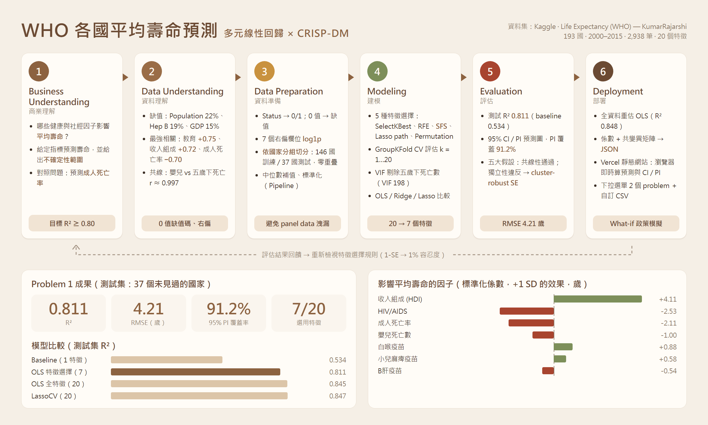

## 加分項目對照

| 加分要求 | 實作 |
|---|---|
| ✅ 下拉選單呈現兩種 problem（+1） | 網頁頂端下拉選單：**Problem 1 預測平均壽命**、**Problem 2 預測成人死亡率**，兩者都有完整的特徵選擇、模型比較、區間圖、假設檢驗與互動預測 |
| ✅ 可任意輸入 Dataset（+2） | 下拉選單第 3 項「自訂資料集」：輸入 CSV 網址（預設 `50_Startups.csv`）或上傳檔案 → 自動判斷數值／類別欄位、one-hot、選目標與特徵、OLS、係數 t 檢定、95% CI／PI 預測圖、**後向消去法**、新樣本預測，全部在瀏覽器計算 |

## 網頁截圖

**Problem 1：KPI 與互動預測**（選國家帶入數值、拖曳滑桿，即時計算預測值與 95% CI／PI）
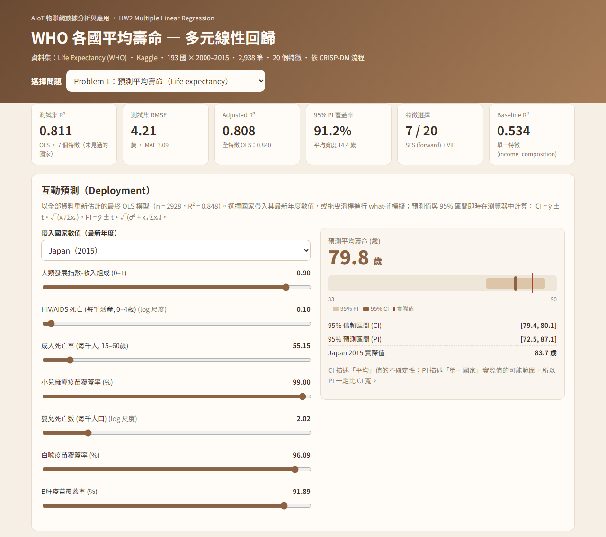

**預測圖與 95% 信賴／預測區間，以及測試集預測樣本表**
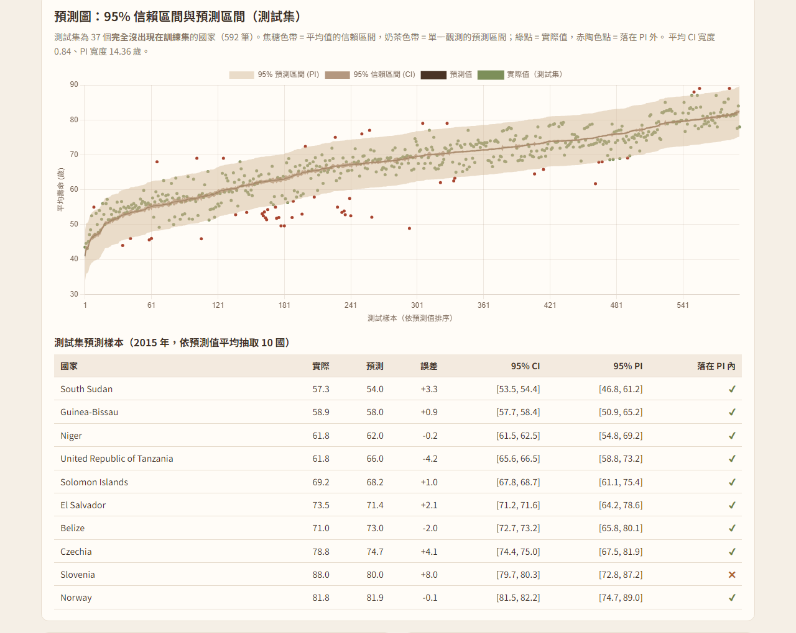

**特徵選擇：5 種方法的 CV RMSE 曲線**
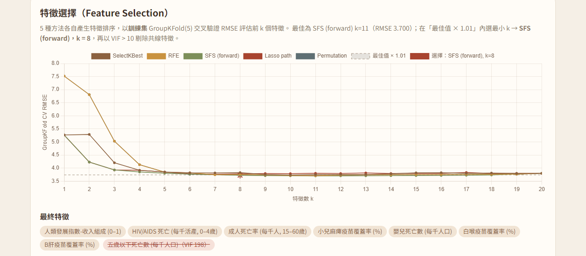

**Problem 2：成人死亡率**（下拉選單切換）
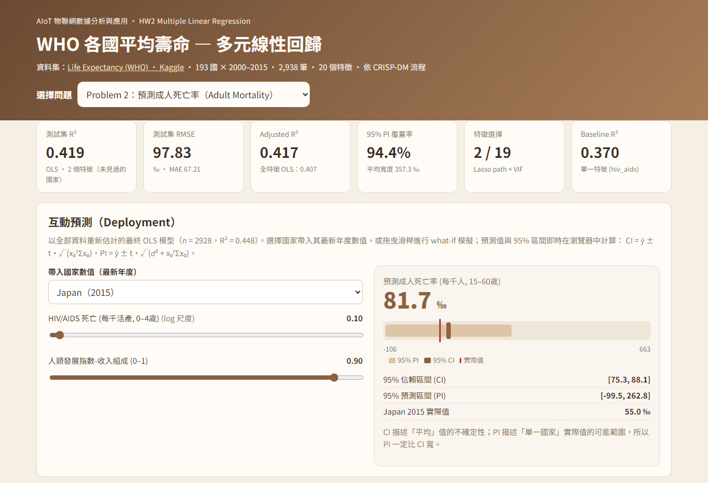

**加分：自訂資料集**（預設載入 50_Startups.csv，自動 one-hot，提供後向消去法）
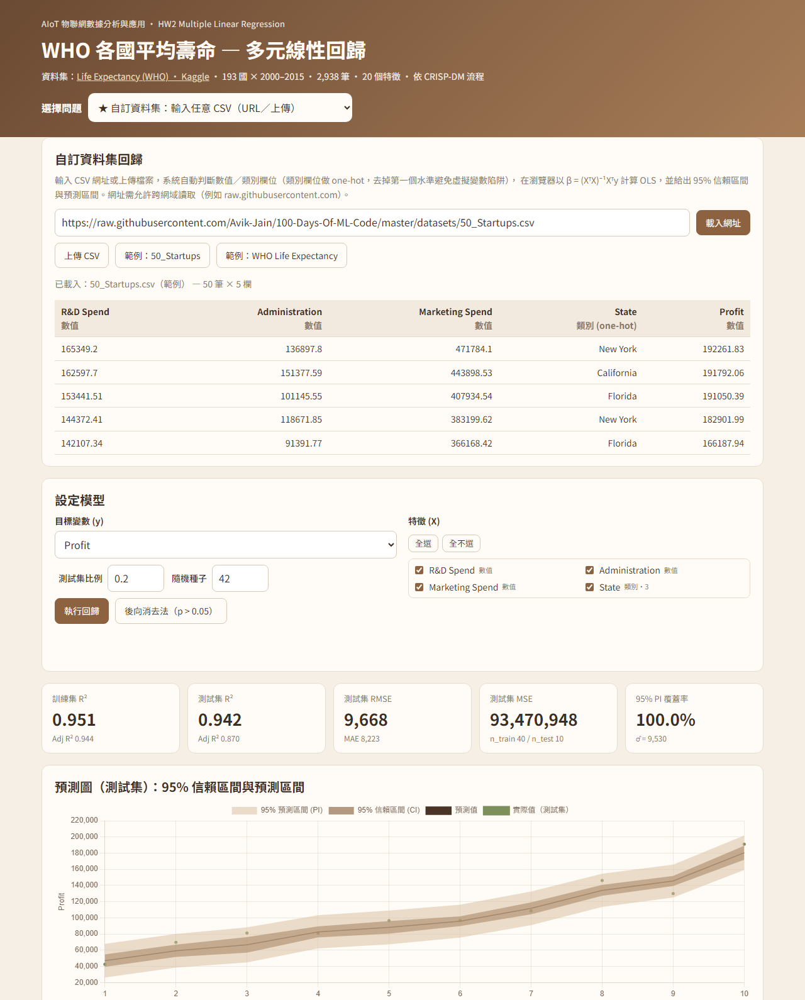

## 專案結構

```
├── index.html / style.css / app.js   # Vercel 靜態網站（Chart.js；OLS 與 t 分配在瀏覽器計算）
├── vercel.json
├── model/problem1.json, problem2.json # Notebook 匯出的最終模型、評估結果、圖表資料
├── notebooks/HW2_Life_Expectancy_Regression.ipynb
├── notebooks/HW2_report.pdf           # 報告書（由本 README 產生）
├── data/Life Expectancy Data.csv      # Kaggle 原始資料
├── data/50_Startups.csv               # 自訂資料集範例
├── assets/crisp_dm_infographic.png    # CRISP-DM 資訊圖表
├── assets/web_*.png                   # 網頁截圖
├── assets/*.png                       # Notebook 輸出圖表
├── tools/build_report.py              # README → 報告書 PDF
└── requirements.txt                   # Notebook 所需套件
```

---

## 1. Business Understanding

平均壽命是衡量國家健康與發展最常用的指標。本作業想回答：

1. 哪些健康與社經因子與平均壽命關係最強？
2. 給定一國的指標，能否預測其平均壽命，並給出**不確定性範圍**？

| | Problem 1 | Problem 2 |
|---|---|---|
| 目標 y | 平均壽命（歲） | 成人死亡率（15–60 歲每千人死亡數） |
| 候選特徵 | 20 | 19（排除平均壽命，避免目標洩漏） |
| 成功標準 | 在「沒看過的國家」上 R² ≥ 0.80 | 對照問題：觀察雜訊較大的目標 |

## 2. Data Understanding

- 2,938 筆 × 22 欄；扣除目標與 `Country`（識別碼）後 20 個特徵。
- 缺值最多：Population 22%、Hepatitis B 19%、GDP 15%。
- 與平均壽命相關最強：受教育年數 **+0.75**、收入組成（HDI）**+0.72**、成人死亡率 **−0.70**、HIV/AIDS **−0.56**。
- 高度共線的特徵：`infant_deaths`↔`under_five_deaths`（r ≈ 0.997）、兩個消瘦率（0.94）、`pct_expenditure`↔`gdp`（0.90）。
- 資料品質問題：`income_composition`、`schooling` 有不合理的 0；`bmi` 有大量不合理值；多個欄位嚴重右偏（偏態 3～16）。

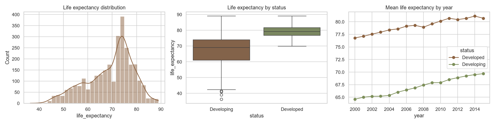
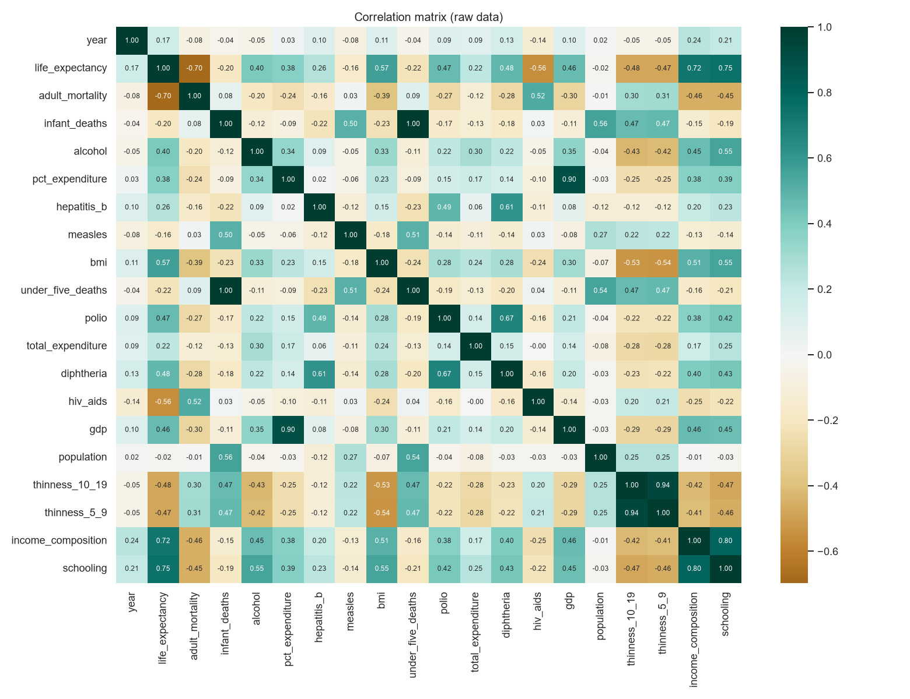

## 3. Data Preparation

1. `Status` → `developed`（0/1）
2. `income_composition == 0`、`schooling == 0` → 缺值
3. 7 個右偏欄位（infant_deaths、pct_expenditure、measles、under_five_deaths、hiv_aids、gdp、population）做 `log1p`，例如 population 的偏態從 15.9 降到 −0.6
4. **以國家分組切分**（`GroupShuffleSplit`，80/20）：train 2,336 筆／146 國，test 592 筆／37 國，兩邊國家**零重疊**。這是 panel data，隨機切分會讓同一國家的其他年份洩漏到訓練集。
5. 缺值補訓練集中位數、標準化只在訓練集 fit（包在 Pipeline 中，CV 每一折各自 fit）

## 4. Modeling

### 4.1 特徵選擇（只用訓練資料）

5 種方法各產生一個特徵排序，再以 **GroupKFold(5) CV RMSE** 評估前 k 個特徵（k = 1…20）：

| 方法 | 類型 |
|---|---|
| SelectKBest (f_regression) | Filter |
| RFE (LinearRegression) | Wrapper |
| Sequential Feature Selection (forward) | Wrapper |
| Lasso path（進入順序） | Embedded |
| Permutation importance | Model-agnostic |

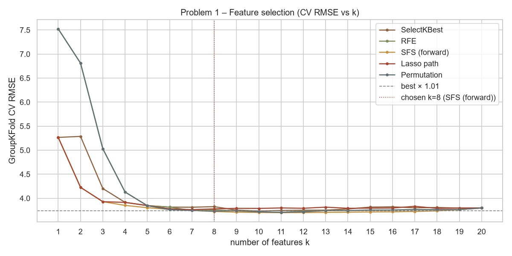

- 全域最佳：SFS k = 11，CV RMSE 3.700
- 規則：在「最佳值 × 1.01」內選最小 k → **SFS，k = 8**（也試過 1-SE rule，但分組 CV 標準誤大，只會留下 3 個特徵，測試集 R² 掉到 0.79）
- VIF 檢查：`under_five_deaths` VIF = **197.6**（與 infant_deaths 幾乎相同），剔除
- **最終 7 個特徵**：收入組成、HIV/AIDS、成人死亡率、小兒麻痺疫苗、嬰兒死亡數、白喉疫苗、B 肝疫苗

### 4.2 模型比較（Problem 1，測試集 = 37 個沒看過的國家）

| 模型 | k | Train R² | MAE | MSE | RMSE | R² | Adj R² |
|---|---|---|---|---|---|---|---|
| Baseline 簡單線性回歸（收入組成） | 1 | 0.693 | 4.68 | 43.53 | 6.60 | 0.534 | 0.533 |
| OLS – 全部特徵 | 20 | 0.862 | 2.88 | 14.47 | 3.80 | 0.845 | 0.840 |
| **OLS – 特徵選擇後** | **7** | **0.850** | **3.09** | **17.71** | **4.21** | **0.811** | **0.808** |
| RidgeCV – 全部特徵 | 20 | 0.862 | 2.88 | 14.46 | 3.80 | 0.845 | 0.840 |
| LassoCV – 全部特徵 | 20 | 0.862 | 2.85 | 14.31 | 3.78 | 0.847 | 0.841 |

**解讀**

- 多元回歸比單一特徵 baseline 的 R² 高出約 0.28。
- 全特徵模型的 R² 多 0.03，但 `infant_deaths` 與 `under_five_deaths` 的標準化係數分別約 +7.2 和 −8.4，互相抵消（VIF 近 200），沒有解釋意義。
- 7 特徵模型的 VIF 全都 < 2.4，係數穩定、可以解釋，最後選它部署。
- Ridge／Lasso 與 OLS 幾乎相同，表示在此樣本量下過擬合不是主要問題。

### 4.3 最終係數（訓練集 OLS，cluster-robust p 值）

| 特徵 | 係數 | p_cluster | 解讀 |
|---|---|---|---|
| 收入組成 (0–1) | +26.93 | <0.001 | HDI 收入組成每 +0.1 → 壽命 +2.7 歲 |
| HIV/AIDS（log1p） | −3.41 | <0.001 | HIV 死亡率越高壽命越低 |
| 成人死亡率 | −0.0171 | <0.001 | 每千人多 100 人死亡 → −1.7 歲 |
| 小兒麻痺疫苗 (%) | +0.025 | 0.003 | |
| 嬰兒死亡數（log1p） | −0.61 | 0.005 | |
| 白喉疫苗 (%) | +0.037 | <0.001 | |
| B 肝疫苗 (%) | −0.024 | <0.001 | 符號為負：與另兩種疫苗高度相關，是控制其他疫苗後的「抑制效果」，不宜做因果解讀 |

## 5. Evaluation

### 5.1 預測圖與 95% 信賴區間／預測區間

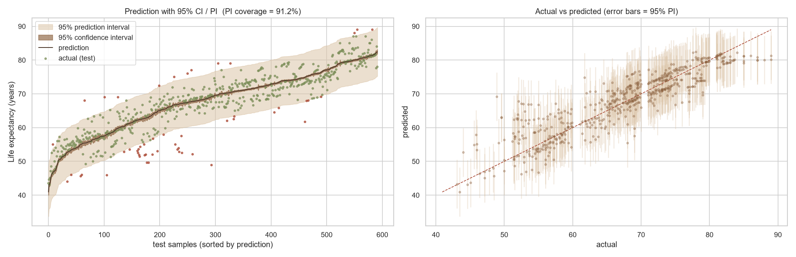

- 平均 CI 寬度 0.84 歲；平均 PI 寬度 14.4 歲（約 ±7.2 歲）
- **測試集 95% PI 實際覆蓋率 91.2%**，略低於 95%。原因是測試國家完全沒出現在訓練集，國家層級的差異無法完全由特徵解釋（分布偏移）。

### 5.2 五大回歸假設

| 假設 | 檢定 | 結果 | 說明 |
|---|---|---|---|
| 線性 | Rainbow F = 1.16, p = 0.006 | ✖ | 輕微非線性（高壽命區間預測偏低） |
| 獨立性 | Durbin-Watson = 0.64 | ✖ | panel data：同國家逐年誤差高度相關 |
| 同質變異 | Breusch-Pagan p < 0.001 | ✖ | 低壽命國家的殘差變異較大 |
| 常態性 | Jarque-Bera p < 0.001 | ✖ | 大樣本下輕微重尾，影響有限 |
| 無多重共線性 | max VIF = 2.33 | ✔ | 特徵選擇後已剔除 VIF > 10 的特徵 |

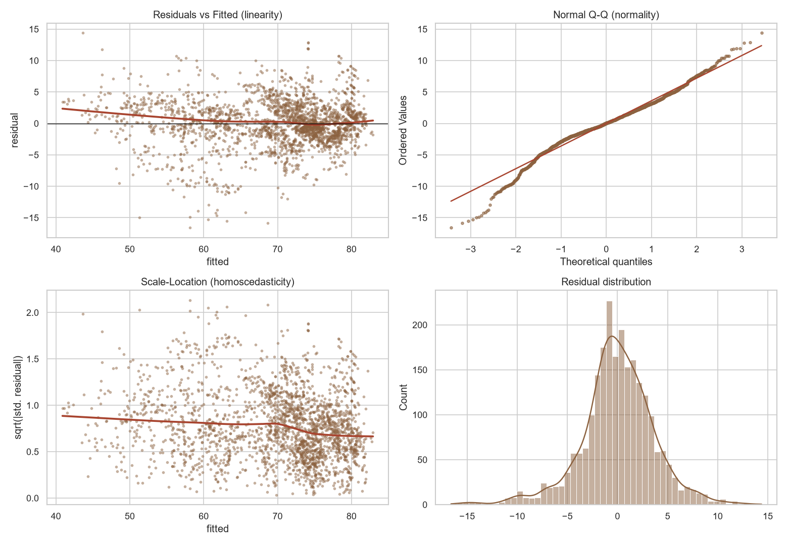

**因應方式**：違反獨立性與同質變異時，OLS 係數仍然不偏，但標準誤會被低估，因此改用**以國家為群集的穩健標準誤**（cluster-robust SE）判斷顯著性。7 個特徵在穩健 SE 下仍然全部顯著（p < 0.01）。未來可改用固定效果或混合效果模型。

### 5.3 Problem 2：成人死亡率

| 模型 | k | R² | RMSE |
|---|---|---|---|
| Baseline（HIV/AIDS） | 1 | 0.370 | 101.8 |
| OLS – 全部特徵 | 19 | 0.426 | 97.3 |
| **OLS – 特徵選擇後（HIV/AIDS、收入組成）** | **2** | **0.419** | **97.8** |
| LassoCV | 19 | 0.430 | 96.9 |

只用 2 個特徵，R² 就和 19 個特徵相當，但整體解釋力只有約 0.42。PI 覆蓋率為 94.4%，可是平均寬度達 357‰，實用性低。原因是這個欄位本身雜訊很大，例如有國家某些年份的成人死亡率僅 1–10，明顯是登錄錯誤。這個對照凸顯了**資料品質對線性回歸的影響**。

## 6. Deployment

1. 以全部資料（2,928 筆）重新估計 7 特徵 OLS（R² = 0.848）
2. 匯出係數、共變異矩陣 σ̂²(XᵀX)⁻¹、補值中位數、log 設定 → `model/problem1.json`
3. 網站（Vercel 靜態部署）讀取 JSON，在瀏覽器即時計算：
   - 預測值 ŷ = xᵀβ
   - CI = ŷ ± t·√(xᵀΣx)，PI = ŷ ± t·√(σ̂² + xᵀΣx)
4. 互動功能：選國家帶入最新年度數值（例：Japan 2015 實際 83.7 歲、預測 79.8 歲，PI [72.5, 87.1]），或拖曳滑桿做 what-if 模擬

### 本機執行

```bash
# 網站（需透過 HTTP 伺服器，直接雙擊 index.html 會無法讀取 JSON）
python -m http.server 8000      # 開啟 http://localhost:8000

# 重新產生分析與 model/*.json
pip install -r requirements.txt
jupyter lab notebooks/HW2_Life_Expectancy_Regression.ipynb
```

### 部署到 Vercel

把 repo 推上 GitHub → Vercel「Add New Project」→ 匯入此 repo → Framework Preset 選 **Other**，Build Command 與 Output Directory 留空 → Deploy。

---

## 結論

1. 在**沒看過的國家**上，7 個特徵的 OLS 可解釋 81% 的平均壽命變異（RMSE 4.2 歲），遠優於單一特徵 baseline（53%）。
2. 收入組成（HDI）、HIV/AIDS、成人死亡率是最主要的三個因子；疫苗覆蓋率有額外但較小的貢獻。
3. 特徵選擇的真正價值不在提升 R²，而在**去除共線性、讓係數可解釋**。全特徵模型多 0.03 R²，但係數互相抵消。
4. Panel data 違反誤差獨立，需要以分組切分評估、以 cluster-robust SE 推論，否則會高估模型表現與顯著性。

---

## 【GPT 輔助內容】

> 本作業使用 **Claude Code（Anthropic）** 作為 AI 輔助工具。對話紀錄匯出 PDF：`notebooks/AI_conversation.pdf` ← 待補

| 項目 | AI 協助內容 | 本人確認／修改 |
|---|---|---|
| 資料集選擇 | 依作業要求（>13 特徵）確認 WHO Life Expectancy 共 20 個特徵 | 本人選定主題 |
| 資料前處理 | 指出 0 值缺值代碼、右偏欄位 log 轉換、panel data 需依國家分組切分 | |
| 特徵選擇 | 實作 5 種方法比較與選擇規則；1-SE rule 只留 3 個特徵、測試 R² 下降，改為 1% 容忍度 + VIF 剔除 | |
| 評估 | CI／PI、五大假設檢驗、cluster-robust SE | |
| 網站 | HTML/JS 靜態網站、瀏覽器端 OLS 與 t 分配；已用 Python statsmodels 交叉驗證 JS 計算結果一致 | |

## 【NotebookLM 摘要】

> ⚠️ 待補：請將網路上同主題（Kaggle「Life Expectancy (WHO)」的 notebooks、相關文章）加入 NotebookLM 進行研究，並將 NotebookLM 產生的摘要（100 字以上）貼在這裡。

（NotebookLM 摘要內容）
